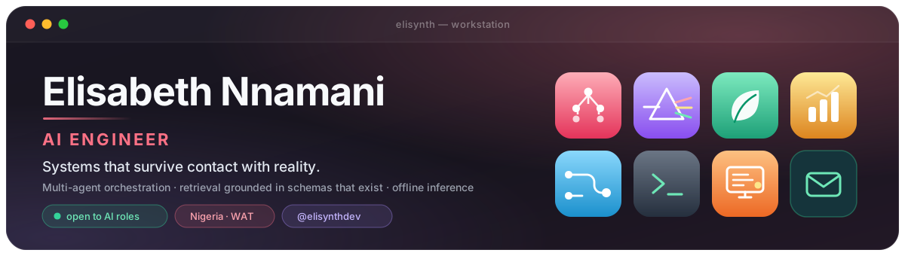
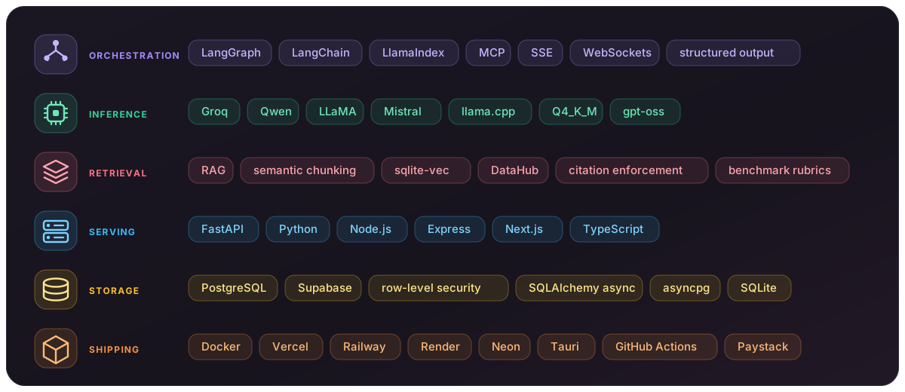

## 🛠️ &nbsp;What's running

<table>
<tr>
<td width="64" align="center"></td>
<td>
<b><a href="https://www.elisabethnnamani.dev/work/prismos">PrismOS</a></b> · <a href="https://github.com/Elisabeth56/PrismOS">repo</a>&nbsp;&nbsp;&nbsp; 
A feature request becomes one reviewed pull request: three critics review the plan, a resolver settles what they disagree on, a verifier checks the result. Postgres is the queue, log and step cache — exactly-once claims, heartbeats and a reaper — so runs survive deploys, refreshes and crashed workers. 
17/18 checks passed in both arms against a 14-file API · 145 API tests · rebuilt from a hackathon prototype in 4 days on free tiers 
<code>LangGraph</code> <code>FastAPI</code> <code>Postgres</code> <code>SSE</code> <code>Qwen3-235B</code> <code>Next.js</code>
</td>
</tr>
<tr>
<td align="center"></td>
<td>
<b><a href="https://www.elisabethnnamani.dev/work/atlas-ai">Atlas</a></b> · <a href="https://github.com/Elisabeth56/atlas-ai">repo</a> · <a href="https://atlas-ai-taupe.vercel.app">demo</a>&nbsp;&nbsp;&nbsp; 
Generates dbt models, tests and docs against the DataHub catalog as the source of truth, and validates the output in code before anything is written back. Runs claim a 60-second lease and resume from the last completed step; approval checkpoints rebuild context from persisted output, so a paused run survives a restart. 
<code>FastAPI</code> <code>async SQLAlchemy</code> <code>Postgres</code> <code>WebSockets</code> <code>Groq</code> <code>DataHub</code> <code>Next.js</code>
</td>
</tr>
<tr>
<td align="center"></td>
<td>
<b><a href="https://www.elisabethnnamani.dev/work/finsight">FinSight</a></b> · <a href="https://github.com/Elisabeth56/FinSight">repo</a>&nbsp;&nbsp;&nbsp; 
Nigerian bank and OPay statements that bank-linking APIs don't cover: parses PDF and CSV, categorises every transaction, answers money questions with exact figures. When Groq retired a model, requests silently fell back while the interface looked normal — provider changes now trigger an eval run with fallback disabled. 
<code>Next.js</code> <code>FastAPI</code> <code>LlamaIndex</code> <code>PostgreSQL</code> <code>Paystack</code>
</td>
</tr>
<tr>
<td align="center"></td>
<td>
<b><a href="https://www.elisabethnnamani.dev/work/farmtwin">FarmTwin</a></b> · <a href="https://github.com/Elisabeth56/FarmTwin">repo</a>&nbsp;&nbsp;&nbsp; 
Crop guidance with no internet on low-spec hardware. Tracks each farm, estimates crop stage and risk, and answers from extension guides using a model running on the machine. Runs on a 2014 laptop with no network connection. 
Qwen2.5-3B beat Llama-3.2-3B on citation fidelity, 83.5 vs 72.9 
<code>llama.cpp</code> <code>Qwen2.5-3B Q4_K_M</code> <code>sqlite-vec</code> <code>FastAPI</code> <code>React</code> <code>Tauri</code>
</td>
</tr>
<tr>
<td align="center"></td>
<td>
<b><a href="https://www.elisabethnnamani.dev/work/flowmind">FlowMind</a></b> · <a href="https://github.com/Elisabeth56/FlowMind">repo</a>&nbsp;&nbsp;&nbsp; 
Files incoming notes and tasks, plans the day, and answers questions from your own notes. Migrating Stripe to Paystack touched the schema, the status enum, webhook verification and the billing UI; prices in NGN and USD. 
<code>Next.js</code> <code>Supabase</code> <code>LangChain</code> <code>Mistral</code> <code>shadcn/ui</code>
</td>
</tr>
<tr>
<td align="center"></td>
<td>
<b><a href="https://www.elisabethnnamani.dev/work/itoms">ITOMS</a></b> · <a href="https://github.com/Elisabeth56/ITOMS">repo</a>&nbsp;&nbsp;&nbsp; 
An IT desk for a small office: a problem reported in under a minute, one queue sorted by due time, and a history attached to each device. 
<code>Next.js</code> <code>TypeScript</code> <code>Supabase</code> <code>PostgreSQL</code>
</td>
</tr>
</table>

## 🧭 &nbsp;How I work

> [!WARNING]
> **A green run is unproven.**
> The failures that cost me most never raised an error: a retired model silently falling back while the UI looked fine, a stray colon in frontmatter making the parser skip two passages without logging it. I work out what a quietly wrong result would look like before I trust a passing one.

> [!NOTE]
> **Set the threshold before the test.**
> Pidgin voice input was the feature I most wanted in FarmTwin — I'm a native speaker. The 40% WER gate went in before testing; Whisper base and a Nigerian-English fine-tune both missed it on a 15-clip evaluation, so it shipped English-only and labelled, written up as ADR-011.

> [!TIP]
> **Grade your own work strictly.**
> FarmTwin's benchmark came out at 98.8 and dropped to 87.6 when I re-read the rubric harshly. The second number is the one in the repo.

> [!IMPORTANT]
> **State the cost of every design choice.**
> PrismOS's multi-agent pipeline spends 22,758 tokens per case against 6,437 for a single prompt, about 3.5×. On the 14-file API eval both arms passed 17 of 18 checks, so that run bought no extra catch. The figure belongs next to the architecture either way.

## 🧰 &nbsp;Stack

## 🌍 &nbsp;Also true

- 🧪 &nbsp;**Freelance AI Engineer, 2025 – present.** Six LLM-backed products end to end: orchestration, grounded retrieval, tenant isolation enforced in the database, billing resilience, deployment.
- 📍 &nbsp;**Local conditions are requirements.** Paystack because the market needs it, offline operation because connectivity is unreliable, statement parsing because the bank APIs don't reach here.
- 🗂️ &nbsp;**Decisions are written down.** Each project carries its ADRs and states what hasn't been verified yet.
- 📬 &nbsp;**Open to AI engineering roles and selected contract work.**

  <a href="https://www.elisabethnnamani.dev">Portfolio</a> ·
  <a href="https://linkedin.com/in/elisabethnnamani">LinkedIn</a> ·
  <a href="https://x.com/elisynthdev">X</a> ·
  <a href="mailto:hello@elisabethnnamani.dev">hello@elisabethnnamani.dev</a>

